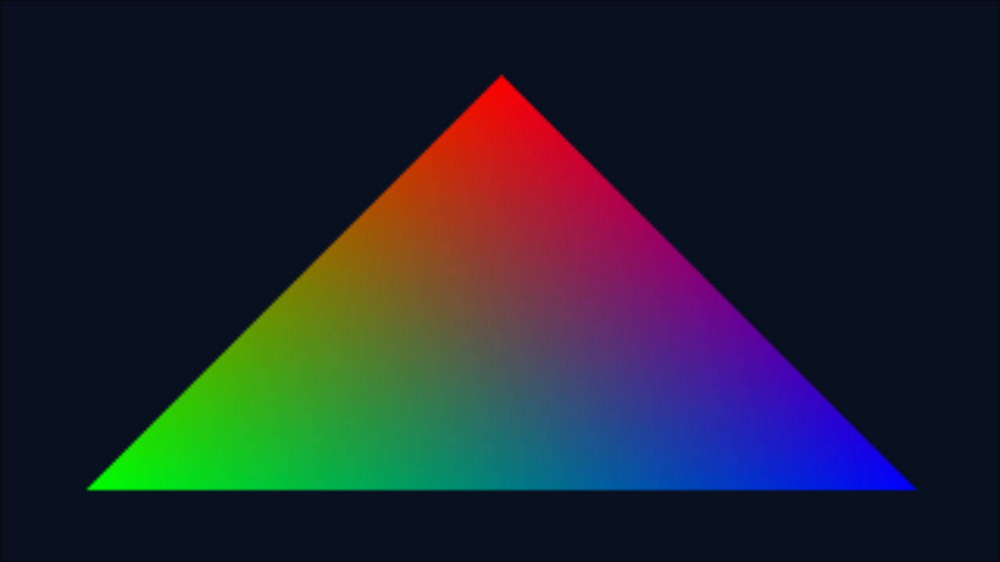

# Actual Eden results — 2026-10-13

These are independent homebrew tests. No Xbox 360 game files, commercial Switch content, keys or firmware were used. Eden's internally synthesized system archives are not a firmware installation. No physical Switch was connected.

| Test | Build | Execution in Eden | Evidence |
|---|---|---|---|
| Console/input | PASS | Text visible, A counter 1/2/3, Plus exit, process code 0 | [report](evidence/2026-10-13/fhnx_smoke.json), [screen](evidence/2026-10-13/fhnx_smoke-after-a.png) |
| ShiftGlue header/arena probe | PASS | Actual upstream endian types, 1 MiB synthetic arena, unaligned accesses, boundary rejection; A/Plus; process code 0 | [report](evidence/2026-10-13/fhnx_runtime.json), [screen](evidence/2026-10-13/fhnx_runtime-after-a.png) |
| CPU framebuffer triangle | PASS | Synthetic RGB triangle, A changes background, Plus exit; process code 0 | [report](evidence/2026-10-13/fhnx_framebuffer.json), [before](evidence/2026-10-13/fhnx_framebuffer-boot.png), [after A](evidence/2026-10-13/fhnx_framebuffer-after-a.png) |
| deko3d triangle | PASS | BLOCKED before a visible frame; host abort (-6) in GPU queue setup | [failure report](evidence/2026-10-13/deko3d-failure.json), [log excerpt](evidence/2026-10-13/deko3d-failure.txt) |
| Audio, real Forza code, race, saves, hardware | Not tested | No claim | Follow-up gates below |

The pictured triangle was rasterized by the application's **CPU**, presented through libnx, then displayed by Eden's Vulkan host backend. It does **not** prove deko3d GPU rendering, switch-nvk, the Xbox renderer, or Forza gameplay.

## Environment and provenance

- Host: Ubuntu 24.04, x86_64, about 9.7 GiB reported RAM; no `/dev/dri` hardware GPU exposed.
- Eden official stable Linux amd64 PGO 0.2.1, from the release linked by https://eden-emu.dev/downloads/.
- AppImage SHA256: `7a28bf988b0648831989722bdbaa90ab31371b403808199813e0ea7c8b25ba6d`.
- Also reproduced the deko3d failure with official 0.2.1 GCC standard AppImage, SHA256 `2fae658397daf13c118082a3eb65d61a6519967b5e22e6667756baecf6000c5a`.
- Host rendering: Vulkan 1.3.274, Mesa 24.0.5 llvmpipe, LLVM 17.0.6 (software CPU driver). This is not a Tegra performance benchmark; Eden reported memory is not the Switch memory allowance.
- devkitA64 r30 / GCC 16.1.0, libnx 4.12.0, switch-tools 1.13.1, UAM 1.1.0, deko3d 0.5.0, switch-examples 20260201. Official devkitPro package databases and downloaded packages were checked with SHA256 and their detached signatures against the official devkitPro keyring before extraction.
- Pinyon Shift `a72a92a5f215a32875386b824b8b6f0f34e1caf9`; ShiftGlue `1e8968f712824b97d4f4330c5a22389c4c8be1b5`.
- Linux Xvfb over loopback TCP, SDL frontend. Keyboard A (`a`) and Plus (`m`) were injected through XTEST into the actual SDL window. Physical controllers were not tested.

Each successful run used a **90-second upper bound**, received three A presses and Plus, and exited in approximately ten seconds. This is not a 90-second stability claim. Captures were reviewed visually. Public reports omit private filesystem paths; complete logs and build outputs remain under ignored `.local/`.

## Reproduced failures and fixes

1. `./scripts/build_switch_smoke.sh` initially failed with permission denied. The executable bit is now committed. `make TARGET=...` replaces a fragile template-editing assumption and output presence is checked.
2. Eden initially had no display or usable Vulkan device. We installed a virtual X server and a system software Vulkan driver; the AppImage launcher needs `SHARUN_ALLOW_SYS_VKICD=1` to see that driver. Creating all isolated config/data parents prevents initialization filesystem errors. X server and client run within the same process environment.
3. A window-title search returned no ID. The integration runner now obtains the actual SDL window ID from `xwininfo`, focuses it and sends held press/release events. Guest events and captures confirm the inputs reached libnx.
4. The original ShiftGlue platform header rejects Horizon with `Unsupported target OS`. The probe creates a local include overlay adding `REX_PLATFORM_SWITCH`, with ARM64 intact and Linux flags inactive. The actual upstream endian/type definitions are used; no substitute implementations or full-runtime success are asserted.
5. deko3d still causes Eden to abort with `std::length_error` (`vector::_M_default_append`) or `std::bad_alloc`. Debug logs reach NVDRV queue/object creation and mappings; the final fully emitted ioctl in one run was `0xC010480B`. This is a location clue, **not a confirmed root cause**. Switching shader storage from RomFS to linked DKSH blobs, disabling Zcull, single-core mode and the official GCC package did not fix it. Default Zcull was restored. The GPU gate remains blocked. No Eden source was modified.

The runner now validates NRO0 image/segment bounds and records a build hash before launch. With `--expect-events`, clean exit or timeout alone fails the gate: ordered application boot/frame/A/Plus/shutdown events are required. Frame submission events alone do not prove correct pixels.

## Next executable gates

1. Isolate the smallest deko3d device/queue-only reproduction and compare another official Eden build; repeat the same homebrew on actual Switch when available. Require a visible GPU triangle before renderer integration.
2. Add a tiny original RomFS fixture with length/hash checks and corrupted/missing fixture cases; then bounded asynchronous streaming with memory high-water telemetry.
3. Add generated PCM tones, submitted/completed buffer counters and underrun tests. Emulated buffer completion is separate from audible output and hardware timing.
4. Extend the ShiftGlue probe to VMX/NEON operations, clocks and bounded thread synchronization. Design a Horizon virtual/physical guest mapping backend before linking the full runtime; a 1 MiB vector does not replace its multi-GiB reserved address space.
5. Compare required Vulkan features/formats with a target-side switch-nvk capability probe before attempting any renderer bridge. Host llvmpipe features are irrelevant to that decision.
6. Only after these gates: user's privately verified FH1 revision, private translation build, menu/track loading, then controlled driving and saves.

CI now includes independent NRO builds and header checks, with no emulator/gameplay claims and no binary publishing. See the PR checks for the current result.
