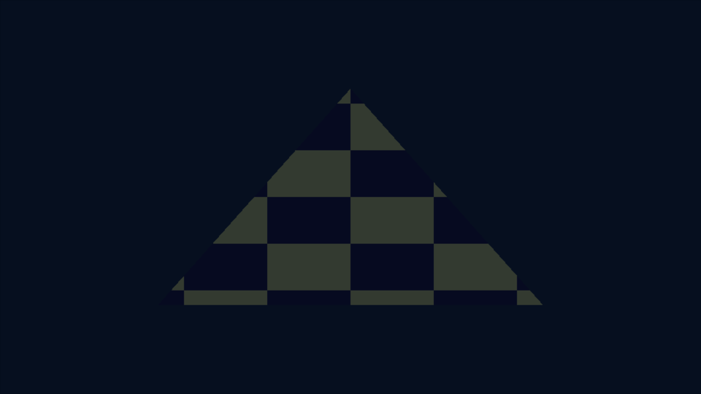
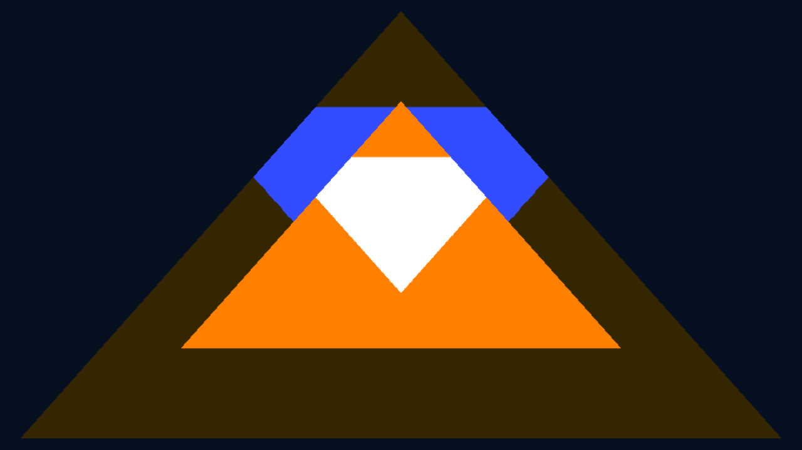

# Continuation from bb0d9d83: GPU passes and ARM64 context

Continues PR #2 without rebasing, deleting earlier evidence, or merging its base or main.
The [previous result snapshot](GPU_RESULTS_2026-10-13.md) and its evidence remain available.
All runs below are independent synthetic homebrew on this host's Mesa llvmpipe,
not physical Switch or Forza execution. Reports, NRO hashes, screenshots, pixel
checks, failed attempts and build logs are in
[evidence/gpu-next-2026-10-13](evidence/gpu-next-2026-10-13/).

## Executed results

| New boundary | Official Eden 0.2.1 PGO / GCC, explicit-upload deko3d | Modified Eden v0.2.1, installed stock deko3d |
| --- | --- | --- |
| Z24S8 stencil | PASS / PASS, pixels and disabled-stencil controls | PASS, pixels and disabled-stencil control |
| Render-to-texture | PASS / PASS, rendered orange/white target sampled; skipped-pass controls stay green | PASS, same pixel/control gates |
| 4x MSAA color resolve | PASS / PASS, multisample RGBA8 target resolved to 1x and sampled; omitted-resolve controls stay green | PASS, same pixel/control gates |
| ARM64 ShiftGlue context | PASS / PASS, final identical NRO | Not rerun; this change targets Eden GPU macro handling |
| Stock clear/present and triangle | Historical stock aborts preserved; no redundant official reruns | PASS, stock macro upload, actual triangle pixels |

Every passing execution above registered three A presses and Plus shutdown,
exit code 0, without timeout. Negative controls also booted and exited normally:
only their fixture output changed. `tools/check_gpu_passes.py` separately checks
visible pixels, control responses, mask coverage, orange offscreen clear, white
offscreen draw, and the green initialized destination when a pass is skipped.
It rejects a positive capture supplied as its own negative control for all three
stages. A process-only pass is insufficient.




Stencil uses a small triangle to replace stencil with 1 while color writes are
disabled, then draws a larger triangle with Equal comparison. Disabling comparison
expands foreground coverage from approximately 15.6% to 45.7% of the capture.
The offscreen fixture renders a white triangle over an orange clear, then samples
that GPU-produced image in a different draw. Resolve uses a separate 2DMS 4x
image and `dkCmdBufResolveImage` into the sampled single-sample target. Full
barriers and image invalidation precede sampling. This verifies this bounded
resolve path; it does not measure antialiasing quality, every sample value,
EDRAM tiling, depth resolve, or arbitrary format support.

Final locally executed NROs (CI rebuilds have independent hashes):

| Fixture | Official PGO/GCC, explicit-upload archive | Modified Eden, stock archive |
| --- | --- | --- |
| Stencil | `c3dbd3ca609d7973c8acb9d8531607b4dd781a8ff52f85f8ebfe93d8ad4697fe` | `76f1ccc9075e45bf348907c93df1373ce03f0f6a3973f794480e9494456e7b06` |
| Render-to-texture | `4bcffadf8050f87406684eb129fd38ef93eb2d19f31f6fac72ca84f0af55d9f4` | `19ebddd2e017b8ede7c3e6c7da9bc7e1f8e7f2049e14668c1a2e2c4472c4e49c` |
| Resolve | `6fc9ecde5473a8e0b7cc310ead1fd1a1fa29950f3e79885bcb85cea6cc53c715` | `2a7477f4412a8fcef4824e71e93e2ba965462f912391e9ca1ecf303e4393a168` |
| ShiftGlue context | `068f642a7fddb3442f240f7b6819af6e234b832276807cd5bc26cc0119ec26e6` | — |

## Modified Eden build

The prior build was no longer running and had no executable. Its GCC13
`dmnt_cheat_vm.cpp` compilation failed under `-Werror=maybe-uninitialized`.
The build now completes against source `58c1e20ee58efa3900ba616207d460886214480b`,
with the existing copy-before-map-insertion macro patch and a **single-file**
CMake diagnostic override. That override retains the warning and changes no
emulation logic. No general `-Werror` removal was applied.

Resuming also exposed missing libdrm/libva development dependencies, an empty
`gl_shader_manager.cpp.o` intermediate (removed and rebuilt), and a FFmpeg
prebuilt reference to `vaMapBuffer2`, absent from this host's libva 2.20.
An isolated directory contains only the libva 2.23 libraries already supplied
by the pinned official Eden PGO AppImage. The built executable uses an explicit
link path and RPATH there; official Eden and the installed deko3d SDK remain
unchanged. Source changes and executable hash are recorded in `build-inventory.json`.
Failed build logs were retained, not overwritten.

`scripts/build_eden_source_patch.sh` supplies the source pin, idempotent patch
application and optional `FHNX_EDEN_LIBVA_DIR` for this dependency arrangement.
It needs host GCC/C++, cmake, ninja, pkg-config, glslang tools, X11/Wayland
and libdrm/libva development headers plus Eden's CPM dependencies. Published
files contain patches and logs, not a redistributed modified Eden executable.
The original ASan and official stock-abort results were not rerun.

## ShiftGlue ARM64 integration

`context_probe.cpp` includes pinned upstream `rex/ppc/context.h` and SIMDe,
instantiates the actual aligned PPCContext and PPCFuncMapping ABI, then executes
independent synthetic PPC-signature functions through a bounded mapping table.
Unknown guest function addresses return null rather than an arbitrary target.
BE stores operate within a 1 MiB region using the existing checked memory adapter.
No title-translated functions are included.

The executed gates cover GPR arithmetic, CR comparison, unaligned BE store,
missing-function rejection, four 32-bit SIMD lanes with wraparound, the four
FPCR rounding modes, and upstream nonvolatile save/restore for GPR/FPR/vector/CR.
SIMD inputs are volatile to prevent constant folding; the saved ARM64 object
exhibits `add v31.4s, v31.4s, v30.4s` and real FPCR MRS/MSR instructions.

The first context run failed before the FPCR/nonvolatile gate. Pinned upstream's
shared `HostToGuest` table decodes x86 order (nearest/down/up/zero), but its ARM64
encoder uses FPCR order (nearest/up/down/zero). A build-generated **Switch-only**
context overlay corrects the inverse mapping. The original failure, intermediate
passing attempt, and final volatile-input runs remain distinct in the evidence.
The upstream checkout was not patched. OS detection still explicitly identifies
Horizon rather than claiming Linux.

This does not link or initialize the full ShiftGlue runtime. Memory aliasing,
kernel services, scheduling, complete VMX instruction coverage and exception
semantics still need adapters; a synthetic function registry is not title loading.

## Reproduce new work

```sh
export DEVKITPRO=/opt/devkitpro
export VK_ICD_FILENAMES=/usr/share/vulkan/icd.d/lvp_icd.x86_64.json
./scripts/clone_upstream.sh
git -C .local/upstream/pinyon-shift/thirdparty/shiftglue-sdk \
    submodule update --init --depth 1 thirdparty/simde
./scripts/build_shiftglue_probe.sh context
./scripts/eden_input_smoke.sh .local/switch-context/fhnx_context.nro /path/to/official/eden-cli SMOKE

# New GPU passes on official Eden; use the already pinned explicit-upload archive.
export FHNX_DEKO_LIBRARY="$PWD/.local/deko-eden/deko3d/lib/libdeko3dd.a"
./scripts/build_gpu_probe.sh stencil
./scripts/build_gpu_probe.sh render-to-texture
./scripts/build_gpu_probe.sh resolve
# Variant names preserve positive NROs and emulator output directories.
FHNX_GPU_VARIANT=disabled FHNX_GPU_DEFINES=-DFHNX_GPU_DISABLE_STENCIL ./scripts/build_gpu_probe.sh stencil
FHNX_GPU_VARIANT=skipped FHNX_GPU_DEFINES=-DFHNX_GPU_SKIP_OFFSCREEN ./scripts/build_gpu_probe.sh render-to-texture
FHNX_GPU_VARIANT=skipped FHNX_GPU_DEFINES=-DFHNX_GPU_SKIP_RESOLVE ./scripts/build_gpu_probe.sh resolve
# Execute each with eden_input_smoke.sh ... GRAPHICS, then compare its captures:
python3 tools/check_gpu_passes.py positive-boot.png positive-after-a.png negative-boot.png --kind stencil

# Source-patched Eden uses the stock SDK, without the explicit-upload workaround.
FHNX_EDEN_LIBVA_DIR="$PWD/.local/eden/AppDir/shared/lib" ./scripts/build_eden_source_patch.sh
unset FHNX_DEKO_LIBRARY
FHNX_GPU_VARIANT=stock ./scripts/build_gpu_probe.sh resolve
./scripts/eden_input_smoke.sh .local/gpu-probes/resolve-stock/fhnx_gpu_resolve-stock.nro \
    "$PWD/.local/eden-stable-build/bin/eden-cli" GRAPHICS
```

New checks: real GPU positive/negative execution in three emulator profiles;
final ARM64 context execution in PGO/GCC; deliberate pixel-checker rejection;
texture/depth regression **compilation only**; shell syntax, diff whitespace and
publication audit. Previously passing 20 Python/2 CTest/ASan results are retained,
not represented as new reruns. CI was extended to compile the new ARM64 context
and the three GPU stages; CI does not execute Eden.

## Next integration boundary

Implement a bounded deko3d resource/command adapter for Pinyon's native executor,
starting with RGBA8 color targets, Z24S8, texture views and explicit resolve.
Compare synthetic command sequences against golden captures/readback before
feeding private game traffic. Separately design Horizon reserve/commit/alias
semantics for ShiftGlue instead of allocating its entire desktop 4.5 GiB arena.
Expand SIMD coverage to representative VMX permutation, saturation and endianness
vectors before claiming a VMX executor. Physical Switch, audio, title loading,
full rendering and Forza gameplay remain unvalidated. No merge was performed.
