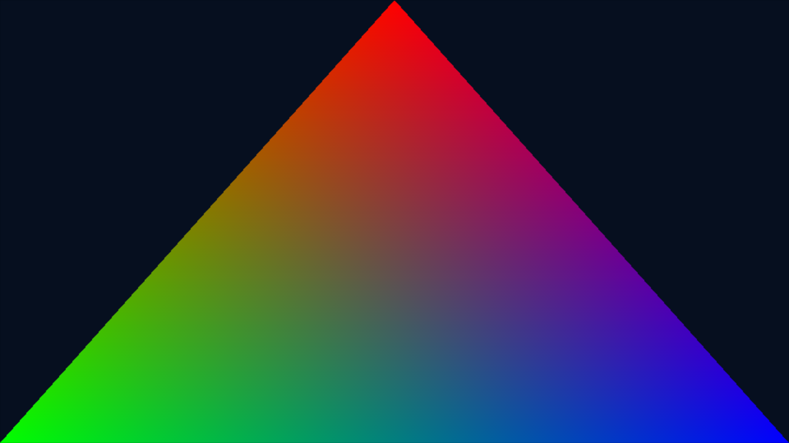
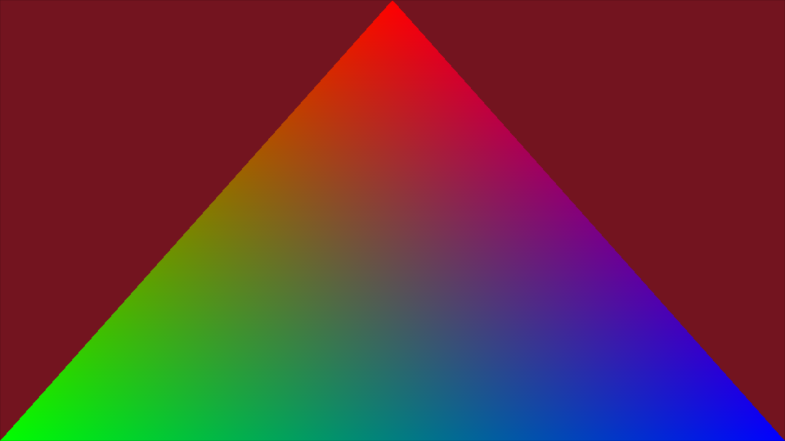
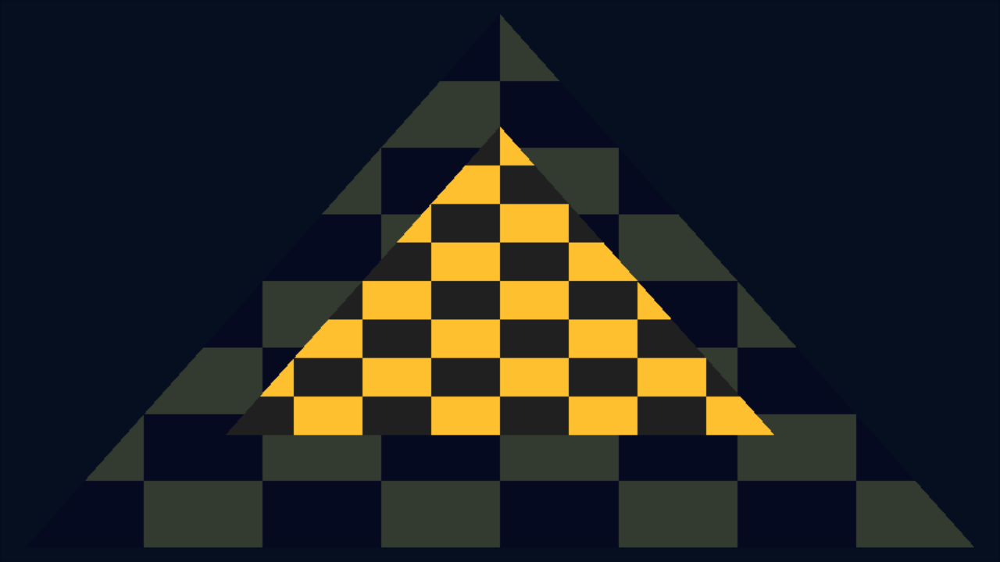
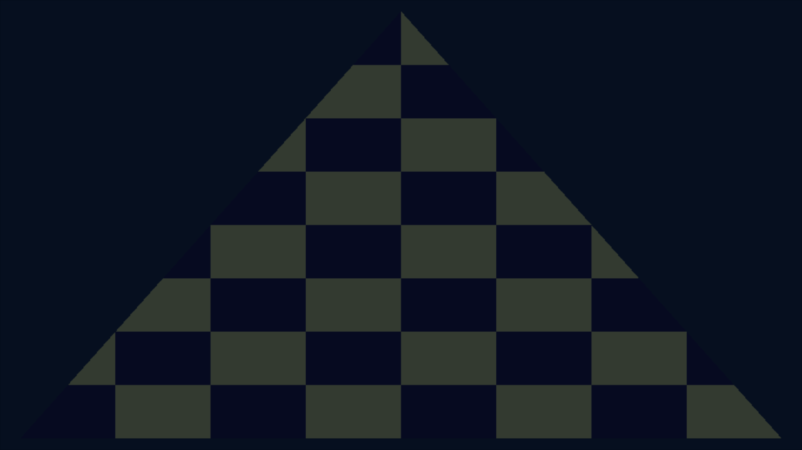

# GPU deko3d on Eden: executed results

The independent deko3d triangle renders on **official Eden 0.2.1 PGO and GCC**, with three A presses changing the background and Plus producing a clean emulator exit (0), without timeout or abort. The same triangle NRO was used for both final runs. A separate textured, depth-tested fixture also passes both versions. These are Switch NROs executed by a Switch emulator on host **Mesa llvmpipe**, not physical Switch or Forza gameplay evidence.

## Actual pixels and controls







The near checkerboard triangle is drawn **first**, the larger far triangle second. With `Less` depth testing, the near triangle remains visible. With depth testing disabled, the far triangle covers it. Pixel checks verify visible fixture pixels, changed background after A, stable center pixels and the depth negative control. `tools/check_gpu_captures.py` requires Pillow. The event runner alone cannot establish visible pixels: an unsupported shader initially submitted frames and exited normally while showing only the background.

Final local NRO hashes:

| NRO | SHA256 | PGO / GCC |
| --- | --- | --- |
| `fhnx_graphics.nro` | `6c64363ed7b63dc2b9554d55274c8b25d95f563db5f2d3567fad5ca012204024` | pixels, A x3, Plus, exit 0 / same |
| `fhnx_gpu_texture-depth.nro` | `188420833a11d29b8b4a2f31910e1196a9acfb418317d34612d7d81a09d569b0` | checker texture, depth, controls, exit 0 / same |

The 90-second setting is a **timeout limit**, not a 90-second endurance run. Input-driven tests exited after roughly 10 seconds. Logs, report JSON, pixel checks, screenshots and build inventory are under [evidence/gpu-2026-10-13](evidence/gpu-2026-10-13/). CI artifacts provide independently compiled homebrew NROs; those builds have their own hashes and are not automatically emulator-validated.

## Isolation and cause

| Independent stage | Stock deko3d, PGO | Stock deko3d, GCC | Explicit macro uploads |
| --- | --- | --- | --- |
| Device create/destroy | PASS, exit 0 | PASS, exit 0 | Not required |
| Queue create/wait/destroy | PASS, exit 0 | PASS, exit 0 | Not required |
| Memory: three 64 KiB block types | PASS, exit 0 | PASS, exit 0 | Not required |
| Swapchain + GPU clear/present, no shaders/draw | abort, exit 134 | abort, exit 134 | PGO PASS, controls, exit 0 |
| GPU triangle, DKSH + draw/present | abort, exit 134 | abort, exit 134 | PGO and GCC PASS |
| GPU DMA copy + CPU readback, 16 x 64 KiB | Not run in this profile | Not run in this profile | PGO and GCC PASS, byte comparison |

The smallest failing **graphics NRO tested** is clear/present without shaders or draw. A smaller **host source reproducer** needs only two entries in `ankerl::unordered_dense::map<uint32_t, vector<uint32_t>>`. It is not an NRO and does not replace emulator evidence.

Full NVDRV logs show `0xC010480B` (`NVGPU_IOCTL_CHANNEL_ZCULL_BIND`) returning through `ZCullBind`; a subsequent `0xC018481B` SubmitGPFIFO call and GPU method processing precede the host exception. ZCULL_BIND is not supported as the cause. The captured PGO throw backtrace is `std::length_error`, `std::__throw_length_error`, then Eden module offsets `0xbc6f68`, `0x9cedd2`, `0x9cd54b`, `0xa41e5a`, `0x192f24a`, `0x194e648`. Official binaries are stripped, so these are offsets, not invented source-level stack names. GDB was attempted but this environment rejects ptrace; `tools/diagnostics/host_backtrace.c` provided an in-process exception backtrace instead.

In Eden v0.2.1 `MacroEngine::Execute`, the lazy macro rebasing path binds a reference to a vector in `uploaded_macro_code`, inserts a new map entry, then reads the old reference. `unordered_dense` stores values contiguously; insertion can reallocate them, invalidating that reference. The erroneous size can cause `length_error` or `bad_alloc`. `scripts/test_macro_rebase.sh` uses hashed v4.8.1 headers, reproduces a real **ASan heap-use-after-free**, then verifies a copy-before-insert correction with the expected seven-word suffix. This source bug, the official host exception and the targeted workaround together strongly support macro rebasing as the failure mechanism.

Async host logging dropped the original guest checkpoints on abort. An additional stock-deko3d NRO with `FHNX_GPU_DURABLE_TRACE` flushes each marker to emulated SDMC. Its last persisted marker was **`FHNX_GRAPHICS render_command_record_end`**; both official builds still aborted with SIGABRT using that same NRO. This is a guest progress witness, not a precise attribution of the asynchronous host worker exception.

## Implemented correction and profiles

The working profile builds a **separate**, pinned deko3d archive. It changes generated MME upload commands from one code upload to overlapping suffix uploads at each existing macro entry. Instruction RAM contents, physical offsets, entry table, DKSH shaders and draw commands remain identical. Eden finds each entry directly and avoids its broken lazy rebase path. The original GPU triangle program still issues deko3d draw/present commands; no CPU framebuffer renderer is used. The installed SDK and official Eden executables remain available for comparison.

Pins: deko3d `350f2b00a3e76ecd4f00191f8c5d6544ffbcb9db`; dekotools `c15523cea963c04fad77a46f23c3a96d26a86ab9`. `tools/deko_macro_upload.py` rejects unexpected generated layouts and verifies instruction RAM equivalence; five unit tests cover preservation and malformed input.

An isolated source fix is supplied as [eden-0.2.1-macro-rebase.patch](../patches/eden-0.2.1-macro-rebase.patch), against Eden tag v0.2.1 (`58c1e20ee58efa3900ba616207d460886214480b`). It copies before insertion and reacquires the code for macro dumping. The full modified Eden build is in progress; its runtime is **not yet validated**. Official nightly `4dc69c06f7` PGO/GCC were also tried but both segfaulted on this host before guest boot; they provide no passing comparison.

Two project-side fixes were also exercised: align extra image allocation sizes to `DK_MEMBLOCK_ALIGNMENT`; link `-lm` for sampler descriptor code. The first texture vertex shader used `% 3`, which UAM lowered to `IMAD(reg)`, unsupported by Eden 0.2.1. The final synthetic fixture uses six explicit vertices and avoids that instruction. This is a shader compatibility workaround, not a claim that arbitrary pipelines work.

## Reproduce

Install official devkitPro switch-dev, switch-examples, deko3d and UAM; host tools `git`, `meson`, `ninja`, `bison`, `flex`, C++ compiler. Keep builds at two jobs by default.

```sh
export DEVKITPRO=/opt/devkitpro
python3 -m unittest discover -s tests -v
./scripts/test_macro_rebase.sh
./scripts/prepare_deko_eden_workaround.sh
export FHNX_DEKO_LIBRARY="$PWD/.local/deko-eden/deko3d/lib/libdeko3dd.a"
./scripts/build_switch_graphics.sh
./scripts/build_gpu_probe.sh texture-depth
# Only after NRO and a functioning official Eden SDL executable exist:
./scripts/eden_input_smoke.sh .local/switch-graphics/fhnx_graphics.nro /path/to/eden-cli GRAPHICS
python3 tools/check_gpu_captures.py .local/eden-tests/fhnx_graphics/captures/boot.png .local/eden-tests/fhnx_graphics/captures/after-a.png --kind triangle
./scripts/eden_input_smoke.sh .local/gpu-probes/texture-depth/fhnx_gpu_texture-depth.nro /path/to/eden-cli GRAPHICS
```

For stock comparisons, unset `FHNX_DEKO_LIBRARY` and rebuild. `build_gpu_probe.sh` supports `device`, `queue`, `memory`, `copy`, `swapchain`, `triangle`, `texture-depth`. Init/copy probes exit immediately and use `test_eden.py --expect-events GPU_PROBE`; the input harness requires a long-lived graphics window. `FHNX_GPU_DEFINES=-DFHNX_GPU_DISABLE_DEPTH` builds the texture negative control; `FHNX_GPU_DEFINES=-DFHNX_GPU_DURABLE_TRACE` enables the optional SDMC file trace in graphics probes. Neither flag is enabled by default.

Linux capture automation requires a working display or Xvfb, xdotool and ImageMagick. This host requires Xvfb TCP (`-nolisten unix -listen tcp`), handled by the harness. Set `VK_ICD_FILENAMES` to a working ICD when required; the tested host used `/usr/share/vulkan/icd.d/lvp_icd.x86_64.json`. To capture NVDRV/GPU traffic, use an isolated Eden config with `log_filter="*:Info Service.NVDRV:Debug HW.GPU:Debug Render:Debug Debug.Emulated:Info"` and `log_filter\default=false`, passed with `test_eden.py --config`.

## Validation and next boundary

Local validation: **20 Python tests, 2 CTest**, ASan original/fixed comparison, actual PGO/GCC init probes, triangle, texture/depth, and GPU copy/readback. The copy probe checks 1 MiB across 16 sequential submissions with 192 KiB of buffer allocations; elapsed guest ticks are recorded but are not Switch performance measurements. CI compiles stock samples and the pinned workaround/probes, validates NRO headers and publishes only independent homebrew artifacts. CI does not run Eden.

Pinyon Shift `a72a92a5f215a32875386b824b8b6f0f34e1caf9` / ShiftGlue `1e8968f712824b97d4f4330c5a22389c4c8be1b5` include a Vulkan native executor (`src/graphics/vulkan/fh1_native_executor.cpp`) with Vk pipelines, resolve/EDRAM transfer passes and format handling. This triangle plus RGBA8 texture/ZF32 depth fixture does not implement that executor. Next bounded tests are stencil, render-to-texture, resolve, more formats and offline shader coverage before an ARM64/libnx backend adapter. The existing endian/arena probe is still only partial runtime integration; VMX, scheduling, audio, title loading and gameplay remain unvalidated.

switch-nvk `6eec707da3ad5f86c64f748226583202801bfd03` requires a separate Mesa/Rust/LLVM toolchain and exposes a VI WSI backend. Its upstream hardware smoke claims are not our tests. No NVK NRO was built or run here, and no compatibility with Eden or Forza is asserted. All commercial title instructions/assets, firmware and keys remain outside this repository.
