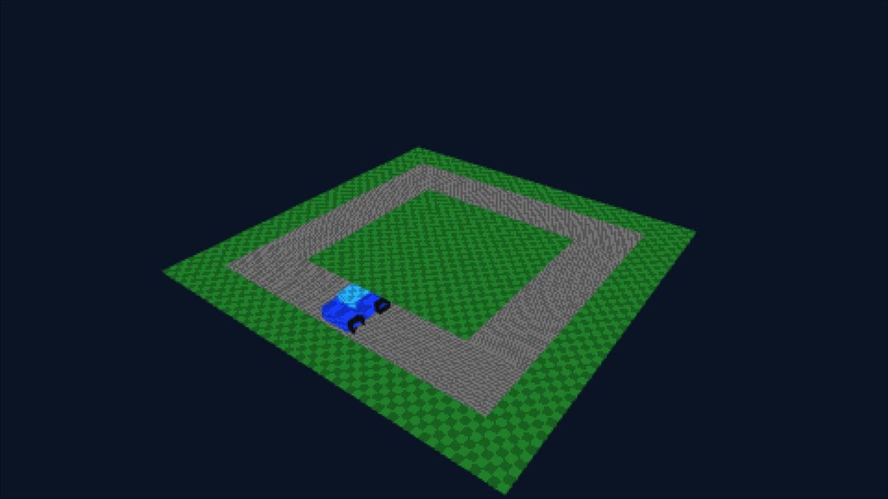
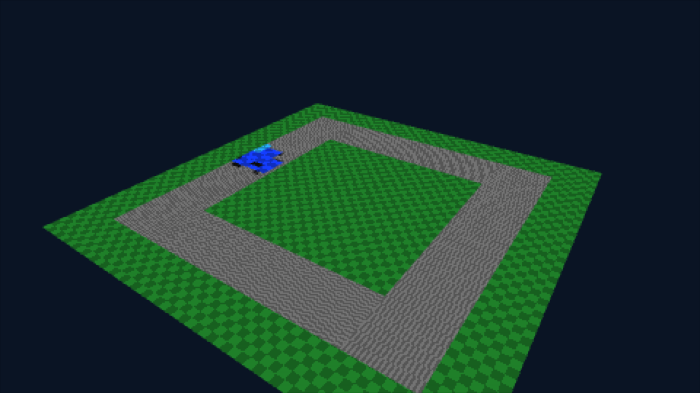

# Pinyon surface integration continuation

Base: PR #3 / `9e1798a40d2725c4df7bc71474b28632d488b233`.
Branch: `feat/pinyon-surface-pipeline-20261013`. No merge or upstream modifications.

## A: real upstream identity and reusable native surface frontend

Inspected Pinyon `a72a92a5f215a32875386b824b8b6f0f34e1caf9` and its SDK
`1e8968f712824b97d4f4330c5a22389c4c8be1b5`. The actual paths within ShiftGlue:

- `src/graphics/vulkan/fh1_native_executor.cpp`: surface allocation, `Transition`, attachment selection and resolves.
- `include/rex/graphics/vulkan/fh1_native_executor.h`: surface image/views, sample count, layout/access tracking, caches and resolve APIs.
- `include/rex/graphics/fh1_edram_surfaces.h`: API-independent `Fh1SurfaceKey`, `Pack`, `Color`, `Depth`, `Fh1PitchTiles` and surface geometry helpers.

`src/graphics/pinyon_surfaces.hpp` includes the **actual upstream header** and
uses those constructors, pitch calculations and packed identities. No surrogate
copy of `Fh1SurfaceKey` is committed. The cache translates disjoint native
RGBA8/D24S8 surfaces, 1x/4x samples and explicit dimensions into `Commands`.
It reuses resources, binds attachments, forwards clear/draw, tracks transitions,
resolves color and copies whole single-sample RGBA8 images. Actual padded deko
allocation bytes drive the separate cache budget. Failed cache allocation rolls
back; explicit shutdown reclaims allocations.

Unsupported 2x MSAA, other formats/gamma interpretation, resize without release,
EDRAM wrapping/overlapping ownership transfers, depth resolve and partial copies
are rejected. This is a functional **surface/command subset**, not the full
Pinyon Vulkan executor, PM4 processor, register decoder, tile ownership system,
guest texture upload, or title shader translator. The synthetic caller supplies
keys/dimensions through the same genuine upstream surface identity boundary.

The build uses a pin-checked local include overlay: explicit Horizon detection
and narrowing `xenos.h`'s memory umbrella include to upstream `memory/utils.h`,
which defines its only required memory names (`fourcc_t`, `make_fourcc`). All
upstream surface/Xenos types and executable inline helpers remain unchanged.
The upstream checkout is never edited and desktop memory APIs are not stubbed.

Validation on official Eden 0.2.1 PGO / existing separate deko macro-upload
workaround / Mesa llvmpipe:

- Real ARM64 NRO uses `Fh1SurfaceKey::Color/Depth` → cache → `Commands` → deko3d.
- Identical key reuses image, unsupported color format and overlapping footprint rejected.
- One-byte cache budget fails with resource accounting rolled back.
- Z24S8 stencil, 4x color resolve, whole-image GPU copy and readback produce expected orange/blue/masked pixels.
- Omitted-copy control leaves explicitly initialized destination green.
- Capture checks compare the new positive run to the preserved earlier negative controls and the newly executed omitted-copy control.
- Both final runs boot, submit frames, register A x3 and exit via Plus with code 0.
- Cache uses 2,621,440 bytes; total owned images 7,536,640 bytes including presentation. Emulated process-used 68,513,792 bytes with a 64 MiB libnx heap. Explicit shutdown returns owned image accounting to zero.

Evidence: [pinyon-2026-10-13](evidence/pinyon-2026-10-13/).
No physical Switch validation, hardware frame-rate claim or Forza execution.

## Reproduction and licenses

```sh
export DEVKITPRO=/opt/devkitpro
bash scripts/clone_upstream.sh
bash scripts/prepare_deko_eden_workaround.sh
export FHNX_DEKO_LIBRARY="$PWD/.local/deko-eden/deko3d/lib/libdeko3dd.a"
bash scripts/build_pinyon_pipeline.sh
VK_ICD_FILENAMES=/usr/share/vulkan/icd.d/lvp_icd.x86_64.json FHNX_SETTLE_SECONDS=10 \
 bash scripts/eden_input_smoke.sh .local/pinyon-pipeline/fhnx_pinyon_pipeline.nro \
 "$PWD/.local/tools/eden-cli" GRAPHICS
# Separate control:
FHNX_PIPELINE_VARIANT=no-copy FHNX_PIPELINE_DEFINES=-DFHNX_PINYON_SKIP_COPY \
 bash scripts/build_pinyon_pipeline.sh
```

ShiftGlue/Xenia BSD-3-Clause notice is preserved in
[licenses/shiftglue-sdk-BSD-3-Clause.txt](licenses/shiftglue-sdk-BSD-3-Clause.txt).
deko3d zlib notice is in [licenses/deko3d-zlib.txt](licenses/deko3d-zlib.txt).
FHNX original code remains MIT; prior test GLSL is original/public-domain-adapted
synthetic content. No commercial title or third-party Vulkan executor source
is redistributed. CI compiles the new pipeline NRO; Eden execution is local.

## B: buffers, shader lifecycle and per-draw descriptors

The `Commands` boundary now accepts bounded vertex, uint16 index and uniform
buffers; explicit float32 attribute layouts; samplers (nearest/linear,
repeat/clamp); RGBA8 upload; indexed draws and shader destruction/reuse. Buffers
use generation-checked handles and a separate 8 MiB padded allocation budget.
The first backend remains synchronous: submit waits for the queue; CPU updates
and resource destruction during recording are rejected. Uniform bindings snapshot
their values with real `dkCmdBufPushConstants`. This is safe command/resource reuse,
not an asynchronous fenced renderer. Vertex/index/uniform ranges and every index
against the vertex count are checked before issuing an indexed draw.

The descriptor arena holds sixteen unique texture/sampler pairs per batch, so
later recorded draws cannot overwrite earlier descriptors. The batch's arena is
reused only after submit/wait. Existing depth/stencil/color-write/shader draw state
remains reusable pipeline state; no general pipeline cache or blend system is
claimed. Programs accept pinned trusted UAM DKSH; SPIR-V is explicitly rejected.

Original `switch/pinyon/buffer_vsh.glsl` consumes real vertex attributes and an
80-byte std140 matrix/tint buffer. The synthetic test draws indexed quads with
red and green procedural textures using different descriptors, samplers and
constant buffers in the same batch. GPU readback verifies both quads, then an
updated left tint produces RGBA `ff000080` while right remains `ff00ff00`.
Captures verify A changes only the red quad, keeping green and background stable.
Stale shader/buffer handles, generation reuse, CPU-update bounds, in-recording
update/destruction and an index 99 outside a four-vertex buffer are rejected.
All final boot/input/Plus/exit gates pass and buffer/image accounting returns zero.

First attempts are preserved: the second readback returned zero pixels. Persistent
readback storage and command-stream constant snapshots together produced correct
updated pixels; these runs do not isolate which of those changes fixed that
emulator behavior. No isolated root cause is claimed. An intermediate passing
run before the added invalid-index/discard gates is retained separately.

Final accounting: 20,480 padded buffer bytes (including the invalid-index control),
5,578,752 image bytes and emulated process-used 68,526,080 bytes with a 64 MiB heap.
Readback staging, code, descriptors and driver allocations are additional to the
image/buffer counters and included only in process accounting. No hardware RAM
or frame-rate claim.

Shader investigation inspected upstream
`include/rex/graphics/pipeline/shader/spirv_translator.h`: its actual
`SpirvShaderTranslator` depends on SPIR-V builder, Xenos translator and Vulkan
device configuration; this is not a standalone DKSH emitter. Installed UAM
compiles GLSL to Maxwell/DKSH and has no documented SPIR-V input option in its
help. The proven path is **original synthetic GLSL → UAM → DKSH → deko3d**.
Xenos microcode → SPIR-V → validated cross-compilation/GLSL → UAM remains an
unimplemented translation boundary; no general Forza shader support is asserted.

Evidence: [buffers-2026-10-13](evidence/buffers-2026-10-13/).
Reproduce with `FHNX_PIPELINE_VARIANT=buffers FHNX_PIPELINE_CLIENT=buffer_probe
bash scripts/build_pinyon_pipeline.sh`, then run its NRO with the existing Eden
input script. The A milestone CI passed both jobs (run 38452095125).

## C: broader Horizon layout and alternative mechanisms measured

`switch/runtime/memory_layout_probe.cpp` queries actual process regions and
performs bounded real SVC experiments. It leaves the ShiftGlue generated pointer
ABI and previous stack-backed prototype unchanged.

| Final official-Eden measurement | Observed result |
| --- | --- |
| ASLR region size | 549,621,596,160 bytes |
| Alias region size | 68,719,476,736 bytes (64 GiB) |
| Stack region size | 2,147,483,648 bytes (2 GiB) |
| Heap virtual region size | 8,589,934,592 bytes (8 GiB) |
| Reserve 4.5 GiB inside alias region | libnx bookkeeping reservation succeeds, no physical commit |
| Map 4096 bytes with `svcMapPhysicalMemory` | Returns `0xFA01` in this process/profile |
| Create 4096-byte shared memory handle | Returns `0x4201`; no duplicate buffers supplied as aliases |
| Self-map heap page with `svcMapProcessMemory` | Returns `0xE401` |
| Protect ordinary own heap page as read-only | Succeeds; kernel query confirms `Perm_R`; restored to `Perm_Rw` |
| Move heap page with `svcMapMemory` into stack | Succeeds; source queried `Perm_None`, destination `Perm_Rw`, original data accessible at destination |
| Unmap moved page | Source access/data restored, backing freed only after successful unmap |
| Emulated process-used after cleanup | 34,873,344 bytes with 32 MiB libnx heap |

All these SVCs were hinted available in Eden; returned errors show that availability
hints do not prove successful allocation/mapping. Kernel Result codes are recorded
without inventing their causes. Source-page permission changes work before moving
it; this does not supply protections on the moved mapping (`0xD401` from the prior
prototype remains valid). Read-only enforcement is established by kernel metadata;
the probe does not intentionally execute an illegal write and recover an exception.

The prior 2 GiB figure is a **stack mapping-region limit**, not the whole Horizon
virtual address space. The measured alias region can accommodate the desktop arena
as a reservation. It still lacks a verified usable commit/alias mechanism in this
NRO profile. A bookkeeping reservation alone is not a mapped/protected guest arena.
The implementation rejects or records unavailable operations instead of claiming
success or duplicating writable aliases.

Preservable now: bounded ordinary heap-page protection; verified MOVE/unmap access
semantics; BE checked accesses in the existing prototype. Needs a different
mechanism: simultaneous coherent physical aliases and protectable sparse pages
inside a contiguous compatible arena. Needs hardware/application-mode validation:
process capabilities/resource configuration, these Result codes and memory budget.
Still incompatible with the current ShiftGlue arena contract: treating moved pages
or scattered heap pages as virtual-base + guest-address and physical-base + 4 GiB.

Evidence: [layout-2026-10-13](evidence/layout-2026-10-13/).
Build with `bash scripts/build_horizon_memory.sh layout`, execute
`.local/horizon-layout/fhnx_horizon_layout.nro` through the existing SMOKE runner.
Final boot, A x3 and Plus exit 0 pass; intermediate narrower probe is preserved.

## D: integrated original 3D technical client

`src/graphics/scene.hpp` provides bounded uint16 meshes, float vertex layouts,
column-major matrices, perspective/look-at transforms and primitive construction.
`switch/pinyon/demo.cpp` builds an original rectangular track, ground and a
vehicle from boxes, with procedural checker textures. Actual vertex/index buffers,
matrix/tint uniforms and DKSH shaders render through the real Pinyon surface
frontend into 480x270 RGBA8/Z24S8 4x targets, resolve to a separate sampled image,
then present through an indexed fullscreen quad. Ground uses depth; road replaces
stencil; vehicle draws with stencil equality. Resources persist across frames and
are explicitly destroyed after queue synchronization.

A changes the camera distance; left stick rotates it; Plus exits. The input script
now optionally tests the observed fresh SDL arrow-key mapping and captures a
third image after analog input. Optional profile suffixes keep emulator data/logs
for comparisons separate. The demo uses ordinary bounded CPU/GPU allocations,
not a fabricated guest arena or altered ShiftGlue pointer ABI.

Accepted executions use **official Eden 0.2.1 PGO (positive)** and **GCC Standard
(omitted-vehicle control)**, the same isolated deko macro-upload archive and Mesa
llvmpipe. The current positive build is byte-for-byte the accepted PGO NRO
`17d74a5947eeba18ada9c2a6be161e8a262966b2393a2dbc60ec654775ef66c2`.
The control is `a1f05184c528f11c1df286621e68b2ba9b217971a217520ef9baea7b07c4c569`:

- Positive GPU readback finds 348 vehicle-blue pixels and 17,547 grass pixels at
  internal resolution, with expected nonzero clear and center colors.
- The separately compiled omitted-vehicle control renders ground/track, finds
  zero vehicle-blue pixels and passes its own readback gate.
- Both accepted runs boot, submit frames, register A x3 and analog movement,
  exit via Plus with process code 0, and reclaim image/buffer accounting.
- Captures verify visible vehicle/ground, camera changes through A and analog,
  and absence of vehicle blue in the control while the rest of the scene remains.
- Host Release tests verify matrix multiplication order, look-at, near/far depth,
  mesh index bounds and upward ground winding. CI builds the scene NRO.

Observed positive accounting: 49,152 buffer bytes, 10,604,544 image bytes,
emulated process-used 68,534,272 bytes with a 64 MiB libnx heap. The accepted PGO positive
sample measured roughly 16.7 ms mean and 50.4 ms maximum frame time. These are
**emulator timings**, including synchronization/presentation; no Switch FPS or
physical RAM claim is made. Individual final run telemetry is in the raw logs.




Failures were preserved. Initial ground winding faced away from the camera and
was culled; correcting it produced actual geometry. Presentation V coordinates
were subsequently corrected for render-target origin. Several PGO and a later GCC attempt
reported host SIGSEGV or heap-corruption messages, sometimes after successful GPU
readback as demonstrated by durable SDMC checkpoints. Their cause is unresolved;
the asynchronous stdout log alone can omit earlier guest events. A file explicitly
marked `STALE-durable-from-prior-run` is not evidence for its failed-startup report.

Experimental same-NRO controls and a pooled-buffer allocation attempt did not
resolve the PGO failures; their code snapshots/patch and logs are retained under
`evidence/scene-2026-10-13`, and those changes are **not in the accepted backend**.
The earlier complete PGO run matches the current rebuilt positive NRO exactly.
A complete GCC run of the equivalent intermediate positive build is also retained,
but later GCC failure means GCC is not claimed as a proven stability fix. The accepted PGO positive and GCC
negative executions provide the evidence, rather than counting a black
failed-boot capture as a successful negative control. The GCC package's SHA256
and successful official zsync SHA1 verification are recorded in
`eden-gcc-package.json`. No modified-Eden executable was rebuilt or tested here.

Reproduce D with `FHNX_PIPELINE_VARIANT=scene FHNX_PIPELINE_CLIENT=demo bash
scripts/build_pinyon_pipeline.sh`; build the separate control with variant
`scene-no-car` and `FHNX_PIPELINE_DEFINES=-DFHNX_DEMO_SKIP_CAR`. Execute each NRO
with `FHNX_TEST_ANALOG=1` and a distinct `FHNX_TEST_PROFILE` for each attempt.
Both official packages are available through the setup scripts; reproduction
still has an unresolved intermittent host-crash risk. `tools/check_scene_pixels.py` compares boot/after-A/after-analog/control
captures. Evidence: [scene-2026-10-13](evidence/scene-2026-10-13/).
`bash scripts/setup_eden_gcc.sh` installs the verified package under `.local`
and creates `.local/tools/eden-gcc-cli`; the original PGO package stays untouched.

## Next technical boundary

The integrated subset now has real upstream surface identity, cache/state/resource
translation, buffers, constants/descriptors, original shaders and a 3D client.
Still missing: actual PM4/register/draw-info decoding into these operations,
EDRAM ownership transfers, guest texture/fetch conversion, Xenos shader conversion
and complete protected/coherent-alias ShiftGlue memory. Physical Switch validation
and the unresolved PGO host crashes are separate follow-up gates. Do not call this
a complete Pinyon executor or Forza runtime. Priorities: decode one bounded real
draw/resolve frontend path and investigate Horizon process/resource settings for
compatible sparse commit/aliases, while preserving the accepted graphics evidence and investigating the host
crashes across both official emulator packages.
