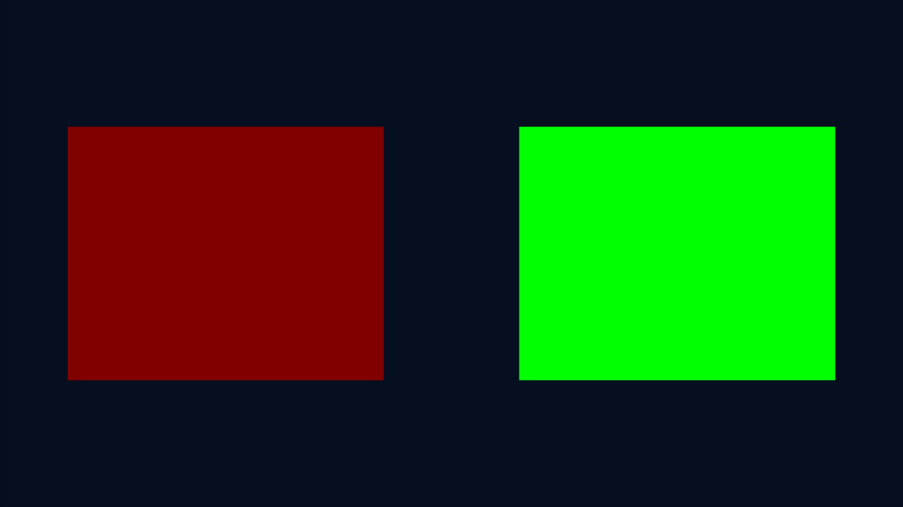

# Bounded PM4 frontend — incremental results

Base: PR #4, a5830e3d61dcbed7eabb64d82511ba74ab0e5f62. No previous evidence changed.

## Upstream contract

Pinyon a72a92a5f215a32875386b824b8b6f0f34e1caf9; embedded ShiftGlue
1e8968f712824b97d4f4330c5a22389c4c8be1b5. Actual sources inspected:
`src/graphics/command_processor.cpp` (ExecutePacketType0, Type3, DRAW_INDX,
ExecutePacketType3Draw); `include/rex/graphics/registers.h`, `xenos.h`,
`fh1_edram_surfaces.h`; `src/graphics/vulkan/fh1_native_executor.cpp`
(PrepareTargetsImpl). All paths relative to the SDK checkout. Existing BSD
notices/licenses remain in docs/licenses; upstream headers are consumed via
pinned checkout and the existing dependency overlay, not copied into this repo.

## Implemented and compiled

`pm4_frontend.hpp` consumes actual big-endian Type 0 register writes (including
write-one), canonical Type 2 and Type 3 NOP / indexed DMA DRAW_INDX. It uses
actual SDK register unions/enums, derives real Fh1SurfaceKey identities and
validates the entire stream before committing its shadow register state.

Bounded subset: triangle lists, 16-bit DMA indices, RGBA8, D24S8, 1x/4x MSAA,
full-target viewport/scissor, no depth or LESS with write, single full color
mask. Unsupported registers, opcodes, predication, conditional draws, formats,
copy mode, index widths, ranges, uninitialized state and partial viewports are
explicit errors. Original synthetic fixture uses upstream packet builders.
Host tests compare independent numeric packet/key/endian references.

`pm4_executor.hpp` maps explicit synthetic DMA address bindings to generation
checked native buffers; no guest pointer ABI changed. It normalizes guest
index endianness, prepares cached native attachments and issues decoded draws.
The new ARM64 client binds original DKSH, vertex/uniform buffers and synthetic
textures outside PM4, then issues decoded draws, native 4x resolve and readback.
This is not fetch/shader translation, full Fh1DrawInfo derivation or the desktop
command processor. Resolve is explicitly a native adapter operation; Xenos COPY
draw region derivation remains unsupported and rejected.

Local ARM64 NRO compiled; header validated. Host ASan+UBSan contract passed.
New NRO SHA256 596abb787a6c688cac129969eb3e58e18bdc82caebd188688dd9fbc52f4d00a6
completed on official GCC Eden: actual decoded draw → native MSAA render target
→ resolve → GPU readback, red/green pixel checks, half-red uniform update,
three A events, Plus, resource counters zero and shutdown. Presentation samples
the resulting resolved texture, not a separate direct recreation of the scene.
Four capture comparisons passed. Guest memory telemetry: process 68,550,656
bytes (~65.38 MiB), images 7,217,152 bytes, buffers 28,672 bytes. 669 frames
recorded; no hardware performance claim.

First CI run 38478566664: ARM64 job passed; portable job failed because the
new C++ test source was inadvertently unstaged. This checkpoint adds that
source. CI is being rerun; the failure is not counted as approval.

## Initial stability diagnosis

Three sequential GCC Standard 0.2.1 attempts of the exact previous scene NRO
SHA256 17d74a5947eeba18ada9c2a6be161e8a262966b2393a2dbc60ec654775ef66c2:
1 accepted complete run, 2 failed runs. All three fresh-profile durable guest
traces contain correct scene readback (blue=348, grass=17547). Failed stdout
can end before emitting buffered guest markers. Those failures are therefore
not correctly classified as pre-guest startup failures. Failure captures are
retained and are not approvals. Two sequential official PGO attempts also
failed after the same correct readback. Overall baseline: 1/5 complete, 4/5
failed. This is a short controlled sample, not a long-duration stability result.

Gdb test with `/bin/true` reports `ptrace: Operation not permitted`; no real
backtrace can be collected here. The existing macro lifetime ASan reproducer
is a separate known defect, already bypassed by the explicit deko macro archive;
it does not establish the cause of these new intermittent crashes. Resource
lifecycle review found idle waits before reuse/readback/destruction, swapchain
destruction before its images, and bounded descriptor storage. This inspection
does not exclude a guest defect or prove an emulator defect. Root cause remains
unresolved; no speculative crash fix is claimed.

Early environment restoration failures (missing X keyboard compiler/Vulkan/
input libraries and incomplete extracted binaries) were pre-guest failures,
not stability approvals. Their logs will be preserved separately from the
controlled repetitions. Official emulation is not Switch hardware validation.

## Reproduce

```sh
export DEVKITPRO=/opt/devkitpro
bash scripts/clone_upstream.sh
bash scripts/test_pm4_frontend.sh
FHNX_DEKO_LIBRARY="$PWD/.local/deko-eden/deko3d/lib/libdeko3dd.a" \
 FHNX_PIPELINE_CLIENT=pm4_probe FHNX_PIPELINE_VARIANT=pm4 \
 bash scripts/build_pinyon_pipeline.sh
VK_ICD_FILENAMES=/usr/share/vulkan/icd.d/lvp_icd.json \
 python3 scripts/eden_stability.py \
 .local/pinyon-pipeline-scene/fhnx_pinyon_pipeline-scene.nro \
 .local/tools/eden-gcc-cli --label baseline-gcc --repeats 3
```

Evidence: [pm4-2026-10-13](evidence/pm4-2026-10-13/).




## Contract correction — 2026-10-14

The initial decoder incorrectly accepted `RB_DEPTHCONTROL=0x26` as LESS.
The pinned upstream `xenos::CompareFunction` declares LESS=1 and EQUAL=2;
`reg::RB_DEPTHCONTROL::zfunc` occupies bits 4..6. With test/write enabled,
LESS is **0x16**, while **0x26 is EQUAL**. The fixture and decoder now construct
LESS through the actual register union and enum, reject EQUAL explicitly, and
request DkCompareOp_Less through a new normalized Draw depth comparison field.
Other native clients retain their previous default depth behavior.

The previous Eden captures and NRO hashes are preserved. They prove actual
native draw/resolve/readback and controls for the historical binary; they do
**not** prove faithful translation of the original 0x26 depth state. This is a
semantic correction, not a demonstrated fix for Eden's host SIGSEGV or the
intermittent uniform-update failure observed in subsequent experiments.

The corrected contract passed host ASan+UBSan with independent raw-bit and
upstream-union checks, negative EQUAL/stencil cases and disabled depth. Twenty
Python tests passed. The previous published checkpoint a9a49c9 has successful
CI run 38479072938 (both jobs). The new corrected NRO still needs fresh Eden
validation; no new screenshot or guest execution is claimed here.

Workspace maintenance removed the temporary checkout and tool installation.
Published code and evidence were recovered from GitHub. Later unpublished
region-copy and shader-export experiments, including their additional local
logs, were not durable and cannot be presented as a completed delivery. Their
reported observations remain provisional until reconstructed and rerun. The
published baseline failures above remain available; no evidence was removed
from Git history.

Next priorities: rebuild and verify this depth-contract correction in Eden;
isolate constant update/reuse; derive bounded Xenos COPY regions; implement
EDRAM ownership transfers; validate a limited microcode-to-GLSL-to-UAM-to-DKSH
path. Keep Vulkan out of the Switch backend and preserve the ShiftGlue pointer
ABI. The available packets are synthetic real-format packets, not Forza traces.
